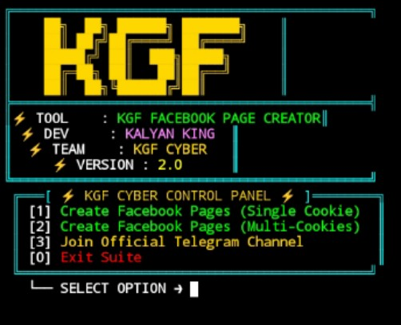

# Facebook_PAGE
<div align="center">


[](https://github.com/kgf-cyber-123/Facebook_PAGE)
[](https://www.python.org/)
[](https://termux.dev/)
[](https://t.me/+WgHH63Mn1pNmZjg1)

</div>

---

<p align="center">
  <b>⚡ ᴀ ᴘᴏᴡᴇʀꜰᴜʟ ᴀᴜᴛᴏᴍᴀᴛᴇᴅ ᴛᴏᴏʟ ᴅᴇsɪɢɴᴇᴅ ᴛᴏ ᴄʀᴇᴀᴛᴇ ꜰᴀᴄᴇʙᴏᴏᴋ ᴘᴀɢᴇs sᴇᴀᴍʟᴇssʟʏ ᴡɪᴛʜ ᴀᴅᴠᴀɴᴄᴇᴅ ᴄʏᴄʜᴏɴ ᴄᴏᴍᴘɪʟᴀᴛɪᴏɴ, ᴍᴜʟᴛɪ-ᴄᴏᴏᴋɪ sᴜᴘᴘᴏʀᴛ, ᴀɴᴅ ʟɪᴠᴇ ᴛᴇʀᴍɪɴᴀʟ ᴀᴇsᴛʜᴇᴛɪᴄs. ⚡</b>
</p>

---

## 📸 𝖕𝖗𝖊𝖛𝖎𝖊𝖜 & 𝖘𝖈𝖗𝖊𝖊𝖓𝖘𝖍𝖔𝖙

<div align="center">
  
</div>

---

## ✨ 𝖈𝖍𝖆𝖗𝖆𝖈𝖙𝖊𝖗𝖎𝖘𝖙𝖎𝖈𝖘 & 𝖐𝖊𝖞 𝖋𝖊𝖆𝖙𝖚𝖗𝖊𝖘

* 🚀 **High-Speed Automation:** Powered by Facebook's internal GraphQL `AdditionalProfilePlusCreationMutation` API for rapid page generation.
* 🛡️ **Cython & Binary Support:** Optimized with `.so` binary compilation for superior execution speed and code security.
* 🍪 **Multi-Cookie & Single Mode:** Supports both single cookie input and batch processing via `cookies.txt`.
* 🤖 **Voice-Assisted Alerts:** Integrated with Termux TTS (`termux-tts-speak`) for real-time voice notifications.
* 🎨 **Stunning Terminal UI:** Features dynamic neon color schemes, 10+ realistic loading animation styles, and auto-changing emojis.
* 🔄 **Smart Anti-Ban Jitter:** Implements randomized countdown delays to mimic human behavior and bypass strict rate limits.

---

## 🛠️ 𝖎𝖓𝖘𝖙𝖆𝖑𝖑𝖆𝖙𝖎𝖔𝖓 & 𝖚𝖘𝖆𝖌𝖊

Run the following commands sequentially in your **Termux** or Linux terminal to clone and execute the tool:

```bash
pkg update && pkg upgrade -y
git clone https://github.com/kgf-cyber-123/Facebook_PAGE.git
cd Facebook_PAGE
python Autocratic_Facebook_page.py
